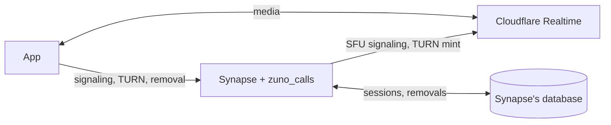
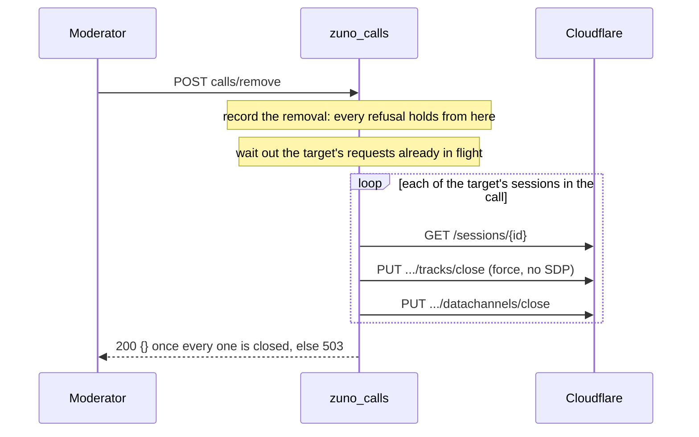

# zuno_calls design

A Synapse module that runs Zuno Chat's calls on Cloudflare Realtime: it proxies SFU signaling, mints TURN credentials, caps call size and removes people from calls. It runs inside Synapse's process, and Synapse checks the Matrix access token on every request, so a device logged out anywhere is refused at once.



## Routes

| Route | Upstream |
|---|---|
| `POST /_synapse/client/zuno/calls/cloudflare/sessions/new?room_id=…&call_id=…` | `{base_url}/v1/apps/{app_id}/sessions/new` |
| `GET  .../sessions/{sessionId}` | same suffix |
| `POST .../sessions/{sessionId}/tracks/new` | same suffix |
| `PUT  .../sessions/{sessionId}/renegotiate` | same suffix |
| `PUT  .../sessions/{sessionId}/tracks/close` | same suffix |
| `PUT  .../sessions/{sessionId}/tracks/update` | same suffix |
| `POST .../sessions/{sessionId}/datachannels/establish` | same suffix |
| `POST .../sessions/{sessionId}/datachannels/new` | same suffix |
| `PUT  .../sessions/{sessionId}/datachannels/close` | same suffix |
| `POST /_synapse/client/zuno/calls/cloudflare/turn/credentials` | `{base_url}/v1/turn/keys/{turn_key_id}/credentials/generate-ice-servers` |
| `POST /_synapse/client/zuno/calls/remove?room_id=…&call_id=…` | none of its own; cuts the removed person off through each backend |

- `sessions/new` names the call the session is for; that query is the module's and never reaches Cloudflare.
- `calls/remove` sits outside `cloudflare/` because removal does not depend on the backend.
- The backend is named in the path so a LiveKit backend can land beside it and both run during a rollover; LiveKit needs none of the SFU routes, since its SDK signals on its own and its server hands out ICE servers, so that seam is the app's call engine.

## Request flow

1. **Route**: method and path segments against the allowlist, before auth; a miss, an unsupported verb included, is 404 `M_UNRECOGNIZED`, never a 405. A `{sessionId}` never matches a literal segment of the table (`new`, `tracks`, …), an empty segment, or one holding a slash, which is how an encoded `%2F` arrives once Twisted has decoded it.
2. **Auth**: Synapse's own, with its 401s.
3. **Rate limit**: a token bucket per (user, device), or per user for a token without a device, shared by every route; over is 429 `M_LIMIT_EXCEEDED` with `retry_after_ms`, and Cloudflare is never called.
4. **Body**: up to 256 KB, over is 413 `M_TOO_LARGE`; TURN's is never read, since its TTL is config.
5. **SFU path**: every segment `[A-Za-z0-9_-]{1,128}`, else 400 `M_INVALID_PARAM`.
6. **SFU session owner**: a `{sessionId}` must be one this user opened through `sessions/new` that the module still keeps (see Sessions), else 404 `M_NOT_FOUND`, the same as one that never existed, because call participants learn each other's ids to pull tracks. Any request on a session bound to a call its owner was removed from is 403 `IM.ZUNO.CALL_REMOVED`.
7. **Call cap**, `sessions/new` only: below.
8. **Pull checks**, `tracks/new`, `tracks/update` and `datachannels/new`: below.
9. **Upstream**:

   | | SFU | TURN |
   |---|---|---|
   | Attempts | One: SDP and track changes are not blindly retry-safe | Up to three, with backoff, on connect failure, timeout, 5xx or 429 |
   | Auth | Bearer App Secret | Bearer API token |
   | Body | The client's, with its Content-Type | `{"ttl": turn_credential_ttl}` |
   | Each attempt bounded by | `timeout` | `turn_timeout` |

10. **Relay**: Cloudflare's status, Content-Type and body byte for byte, except step 8's refused entries put back in their list; no usable response is 502 `M_UNKNOWN` "calls service unavailable".

Success responses carry no CORS headers, as Synapse adds them only to its own error responses; none are needed, since the native app never preflights.

### Call cap

- `room_id` must start with `!` and `call_id` be non-empty, both at most 255 characters, else 400 `M_INVALID_PARAM`; the caller must be joined to the room, else 403 `M_FORBIDDEN`.
- A caller removed from the call is 403 `IM.ZUNO.CALL_REMOVED`, refused before the cap so the attempt holds no place.
- Participants are the distinct users other than the caller with a live `m.call.member` entry for the call (`expires_ts` later than now) or a reservation; at `max_call_participants` the open is 403 `IM.ZUNO.CALL_FULL` with `max_participants`, and Cloudflare is never called.
- Otherwise the caller holds a reservation for 60 s, enough to publish tracks and its own `m.call.member`; a failed open releases it.
- Counting and reserving are one step, so two opens racing for the last place cannot both pass.
- The caller never counts against themselves, so a rejoin always passes.
- Temporary: an open naming neither `room_id` nor `call_id` (app releases up to v1.3.0) skips the cap; once the oldest supported release names the call, a missing one becomes 400 `M_MISSING_PARAM`.

### Pull checks

The body must be a JSON object, else 400 `M_NOT_JSON`, and is relayed as parsed, so Cloudflare pulls exactly what was checked. Every entry of `tracks[]` or `dataChannels[]` other than a plain `local` one names the session it pulls from; `tracks/update` can point a transceiver at another session's track, and `datachannels/new` subscribes to another session's channel.

| The pulled session | Outcome |
|---|---|
| Bound to a call the puller was removed from | The whole request is 403 `IM.ZUNO.CALL_REMOVED`: no honest client makes it |
| Belongs to someone removed from its call, or from the puller's when it names none | That entry refused, `IM.ZUNO.CALL_REMOVED` |
| Bound to another call than the puller's bound session, or unknown while the puller's is bound | That entry refused, `IM.ZUNO.TRACK_NOT_IN_CALL`, data channels included |
| Anything else | Relayed |

- A refused entry stays at its place in the list, in Cloudflare's own per-entry `errorCode`/`errorDescription` shape, and never fails the request, because the app rejoins on a failed pull and calls on without a refused channel; when every entry is refused, Cloudflare is not called.
- Temporary, with the cap: a pull with an unbound side (app releases up to v1.3.0) skips the binding check, never the removal checks.

## Sessions

Each session opened through `sessions/new` is kept with its owner, its call and its open time in Synapse's database, so a restart forgets none: a forgotten session is out of a removal's reach.

| A session is forgotten when | Closed first |
|---|---|
| It is bound to a call, older than the 60 s reservation, and its owner's `m.call.member` event no longer lists that call | Yes |
| Its owner holds more than 32 besides those, oldest first | Yes |
| It is older than seven days | No: it is long dead, and this bounds a session whose close never succeeds |

- Closing is a removal's cut-off on the whole session and runs in the background, so `sessions/new` answers as soon as Cloudflare has opened the session and it is saved.
- An account's sessions are closed and forgotten one at a time, so none is closed twice; each open starts its owner's closes, and a periodic sweep starts everyone's.
- A failed close keeps the session for a retry after a growing wait while the account's next-oldest goes instead, so a stuck session never slows an open or holds an account over the cap for long.
- Requests on a session being closed are 404, while a removal still reaches it.
- An entry that has only expired does not end the call, because nobody can refresh while Synapse is down and counting expiry would cut live calls on a restart.
- The sweep runs on every process but acts only on one that has served a call request since it started, so a worker never closes the main process's sessions.
- Unbound sessions (app releases up to v1.3.0) go only by the cap or by age.

## Removal

`POST calls/remove?room_id=…&call_id=…` with `{"user_id": "@target:server"}` removes someone from a call and answers only once they are cut off.

**Who may remove whom**

- The query is validated as for `sessions/new`; the body must be a JSON object (400 `M_NOT_JSON`) whose `user_id` is a string (400 `M_BAD_JSON`) holding a Matrix user ID (400 `M_INVALID_PARAM`).
- The caller must be joined to the room, at or above its `kick` level (50 when unset), above the target and not the target, else 403 `M_FORBIDDEN`.
- Power levels follow Synapse's own computation: without `m.room.power_levels` the creator has 100 and everyone else 0, and from room version 12 the creators outrank every level.

**Cutting off**



- A session bound to the call has every track and data channel closed; an unbound one, only those it pulls from sessions bound to the call.
- Requests in flight are waited out because they could still add a track or channel; later ones are not, since on a bound session they are refused.
- A session Cloudflare answers 4xx (but 429) for carries no media and needs no close.
- Anything short of every close is 503 `M_UNKNOWN` with the record kept, and the moderator's retry finishes it.
- Cloudflare names no "already closed" error for a data channel, so one that closes on its own between the read and the close costs a 503 and a retry.
- The route is idempotent: the same removal again answers 200, also for a target not in the call, who is kept out either way.

**Records** are `(room_id, call_id, user_id, removed_by, removed_at)` in Synapse's database, so a restart keeps a removed person out. A call's records go once a `sessions/new` for it finds no live `m.call.member` left; records older than seven days go on the next load, for calls never opened again.

## State

| State | Kept in | After a restart |
|---|---|---|
| Sessions | Synapse's database, table `zuno_calls_cloudflare_sessions` | Kept |
| Removal records | Synapse's database, table `zuno_calls_removals` | Kept |
| Rate-limit buckets, call reservations, close retries | Process memory | Lost, harmlessly: buckets refill, reservations lapse, closes retry |

- Both tables are created on first use, read once per process and then held in memory; additions reach the database before memory, so a restart never forgets one the module acted on.
- Per-process state is enough because the gateway routes these paths to the main process alone.

## Config

```yaml
modules:
  - module: zuno_calls.ZunoCalls
    config:
      max_call_participants: 6                                # default; any backend
      cloudflare:
        app_id: "..."
        app_secret_path: /data/secrets/cf_calls_app_secret    # or app_secret
        turn_key_id: "..."
        turn_api_token_path: /data/secrets/cf_turn_api_token  # or turn_api_token
        base_url: https://rtc.live.cloudflare.com             # default
        turn_credential_ttl: 2h                               # default
        timeout: 10s                                          # per SFU attempt, default
        turn_timeout: 5s                                      # per TURN attempt, default
      rate_limit:                                             # per (user, device)
        per_second: 5
        burst: 10
```

- No `cloudflare` section: the module loads and registers nothing, and Synapse answers 404. That is the off switch.
- Secrets: exactly one of inline or `_path`; the file is read verbatim minus one trailing newline. `_path` exists because Synapse replaces top-level keys per config file, so `modules:` cannot be split into a generated secrets file.
- Durations: `500ms`, `10s`, `5m`, `2h`, `1d` or a number of seconds.
- Unknown keys and every other problem are reported together in one `ConfigError`, so Synapse refuses to start with the full list.
- `modules:` is shared config, so workers load the module too and mount its resources; construction does no I/O and the sweep acts only where calls are served, so a worker costs nothing.

## Upstream client

- Its own Twisted agent and connection pool, not Synapse's shared HTTP client, which has a fixed 60 s timeout and shares its pool with Synapse's other outbound traffic.
- Each attempt, connect included, is bounded by `timeout` or `turn_timeout` (step 9); redirects are never followed; certificates are checked against the system CAs.
- A response body over 1 MB is no usable response.
- Idle connections are dropped well before Cloudflare closes them, because reusing a dead keep-alive fails without a response byte and the SFU never retries.

## Metrics and logs

| Series | Counts |
|---|---|
| `zuno_calls_rate_limited_total` | Requests refused by the limiter |
| `zuno_calls_call_full_total` | Opens refused as `IM.ZUNO.CALL_FULL` |
| `zuno_calls_removals_total` | Removals that passed the power check |
| `zuno_calls_removed_refusals_total{route,scope}` | Every `IM.ZUNO.CALL_REMOVED`; `scope` is `request`, `track` or `channel` |
| `zuno_calls_upstream_requests_total{api,code}` | Cloudflare responses by status |
| `zuno_calls_upstream_seconds{api}` | Cloudflare latency per attempt |
| `zuno_calls_upstream_retries_total{api}` | Retried attempts |
| `zuno_calls_upstream_errors_total{api,reason}` | Attempts with no usable response; `reason` is `timeout`, `connect`, `too_large` or `other` |

- `api` is `sfu` or `turn`. Per-route counts and latency come from Synapse's own `synapse_http_server_*`, labelled by resource class: `SFUResource`, `TurnResource` and `RemoveResource`.
- Every Cloudflare attempt with no usable response logs a warning under `zuno_calls.upstream` with its API and reason, and every failed background close logs one naming the session.

## Tests

- `make test`: unit tests against a fake Synapse module API and a fake Cloudflare, plus a real local Twisted server for the upstream client.
- `make e2e` (Docker, opt-in, never in CI): the module inside `synapse:v1.164.1` against a stub Cloudflare. It proves loading, config parsing, path registration, Synapse's auth, the call cap's room-state read, the rate limit, and a removal through real power levels and the real database followed by a refused rejoin.
